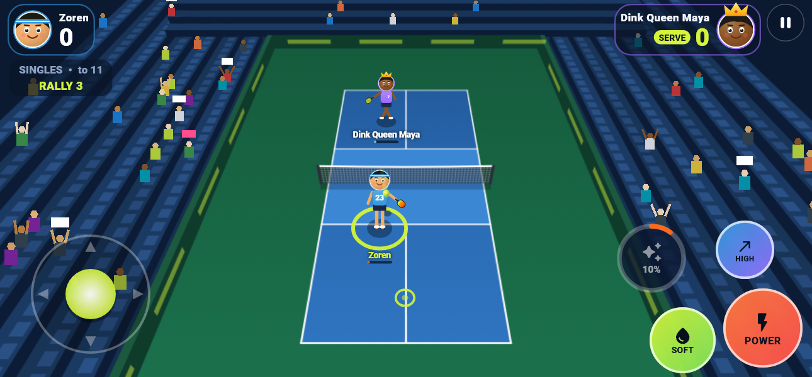
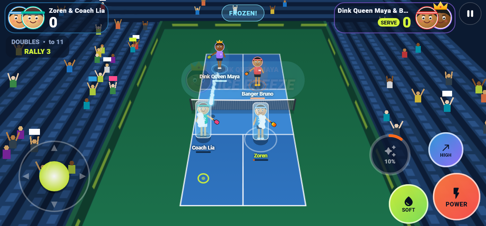
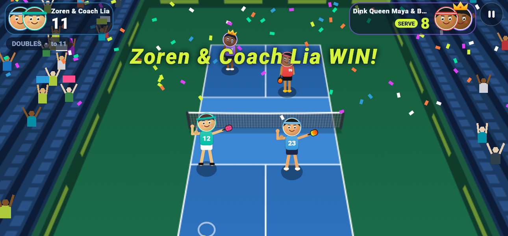
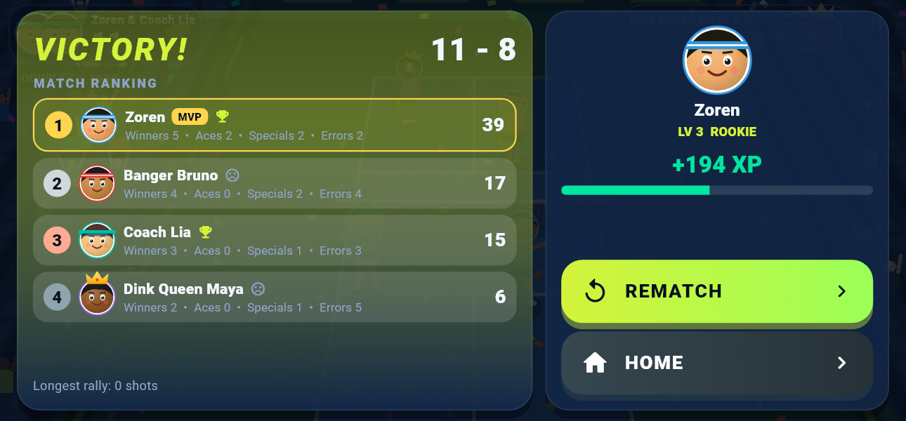
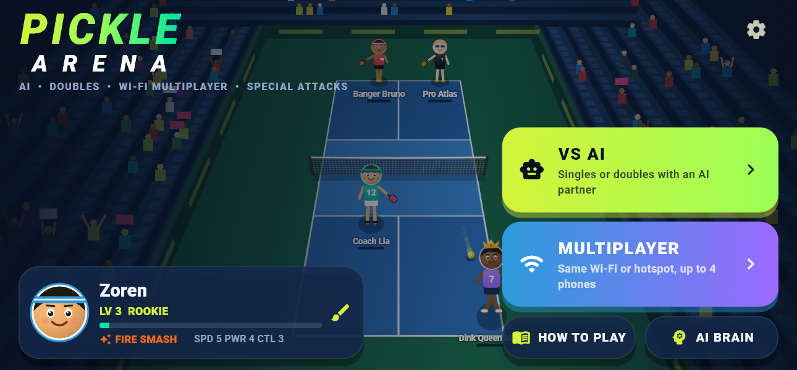
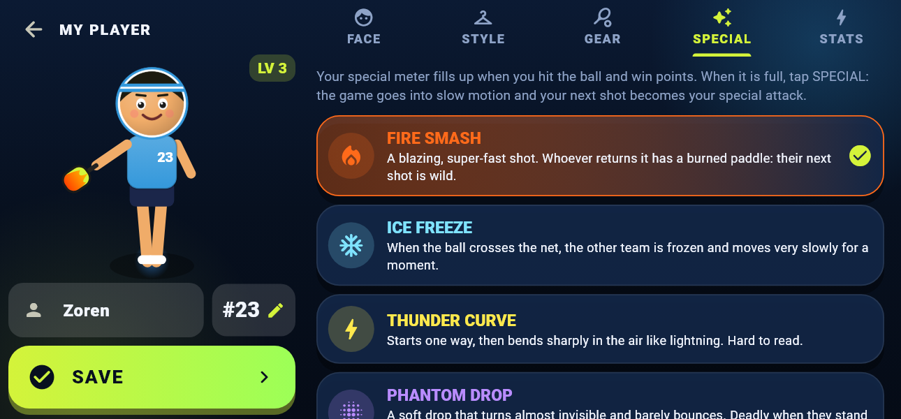

# Pickle Arena

**A mobile pickleball game with neural-network AI opponents, singles and doubles, phone-vs-phone
Wi-Fi multiplayer, special attacks in slow motion, and characters that wear your own face.**
Built with Flutter (Android) and TensorFlow/Keras.

<p align="center">
  
  
  
  
  
  
</p>

**Download:** get the APK from the [Releases](../../releases/latest) page
(`PickleArena-arm64.apk` works on most phones; use `PickleArena-universal.apk` for older 32-bit phones).

**Tech:** Flutter / Dart (custom 2.5D renderer, no game engine) · TensorFlow / Keras · NumPy ·
Google ML Kit face detection · UDP discovery + TCP sockets · Kotlin (Android multicast lock) ·
audio processed with NumPy + libsndfile

## Features

- **VS AI** – singles, or doubles with an AI partner. 5 AI opponents driven by two neural networks trained
  in Python (TensorFlow/Keras); in doubles the AIs split the court and cover for their partner.
- **Wi-Fi multiplayer** – 2 to 4 phones on the same Wi-Fi or a phone hotspot, no internet needed.
  Singles or doubles; empty doubles spots are played by the AI (choose its level).
- **Special attacks** – a meter fills as you play; when full, tap SPECIAL: the game goes into slow motion
  and your next shot becomes FIRE SMASH (burns the returner's paddle), ICE FREEZE (freezes the other team),
  THUNDER CURVE (bends in the air), PHANTOM DROP (turns invisible, barely bounces) or TORNADO HIGH
  (kicks sideways). The AI uses its own special at smart moments.
- **Tactics** – POWER / SOFT / HIGH shots; hold the joystick left/right to aim and up/down to hit deeper or
  shorter (e.g. a short SOFT drop when your opponent is far back).
- **Character customization** – your own face (selfie or gallery, auto-cropped with ML Kit face detection),
  jersey/shorts/shoe colors, paddle color and design, headwear, editable jersey number, skill points
  (Speed / Power / Control) and your special attack.
- **High camera** – the court is seen from above, behind your baseline: players never hide the ball, the
  landing marker shows where the other side hit it, and the joystick and buttons sit beside the court
  instead of on top of it.
- **Stadium atmosphere** – a small crowd in tiered stands that jumps, waves and holds up signs; real crowd cheers, "aww"s and
  applause, a match announcer ("Ace!", "Match point!", "Victory!"), paddle hits, footsteps,
  special-attack sounds and licensed music (see [AUDIO_CREDITS.md](AUDIO_CREDITS.md)).
- **Victory scene, ranking and XP** – the winners celebrate in slow motion while the losers hang their heads,
  then everyone is ranked (MVP) and you earn XP and level up (Rookie to Legend).
- **Phone controls** – landscape; floating joystick that follows your thumb (or a fixed one), with
  adjustable size and sensitivity, move assist, left-handed layout, or tilt-to-move; haptics.
- **Settings** – volume for master / music / effects / crowd, announcer on/off, graphics quality
  (Low / Medium / High), screen shake, FPS counter, button size, game speed.
- **Smooth on mid-range phones** – the stadium is drawn once into a cached image, the whole crowd is
  one GPU draw call, text and faces are cached, and the HUD only rebuilds when something changes.
  Physics runs in fixed 1/120 s steps, so a slow frame never turns into slow motion.
- Real pickleball rules: diagonal underhand serve, two-bounce rule, kitchen (non-volley zone), out / net /
  double-bounce faults, rally or traditional scoring, doubles side switching, second server and 0-0-2 start,
  win by 2.

## Folder structure

```
pickle_arena/
├─ lib/
│  ├─ main.dart                 app start (loads profile + AI model)
│  ├─ app_state.dart            profile, settings, win/loss record (shared_preferences)
│  ├─ models/profile.dart       player look, stats, face photo
│  ├─ game/
│  │  ├─ physics.dart           exact ball physics (gravity + drag, bounces, net)
│  │  ├─ shot_planner.dart      turns "DRIVE to that spot" into a launch velocity
│  │  ├─ game_state.dart        match state + network snapshot format
│  │  ├─ engine.dart            rules, scoring, specials, doubles serving (authoritative)
│  │  ├─ session.dart           VS-AI / Host (up to 4 phones + AI fill-ins) / Client sessions
│  │  ├─ ai/brain.dart          runs the trained neural networks on the phone
│  │  ├─ ai/ai_controller.dart  AI player logic + difficulty levels
│  │  ├─ ai/roster.dart         the 5 AI opponents, their styles and specials
│  │  └─ render/                stadium + crowd, bobble-head characters, special FX, victory poses
│  ├─ net/lan.dart              UDP room discovery + TCP game connection
│  ├─ services/face_service.dart camera/gallery + ML Kit face detection + crop
│  ├─ services/sound_service.dart sound effects, crowd and music
│  ├─ screens/                  home, customize, face crop, VS AI, lobby, game, settings, guide
│  └─ ui/                       theme, joystick/buttons/tilt, avatars
├─ assets/ai/pickle_brain.json  trained weights (exported by training/train_ai.py)
├─ assets/audio/                sound effects, crowd, announcer and music (OGG/WAV)
├─ tools/make_sounds.py         synthesizes the special-attack, footstep, net and UI sounds with NumPy
├─ tools/make_audio.py          trims, mixes and converts the CC0/CC-BY recordings to OGG
├─ training/
│  ├─ pickle_sim.py             Python twin of the game physics
│  ├─ train_ai.py               data generation + training + export
│  └─ outputs/                  training curves, accuracy plots, learned policy map, metrics.json
└─ test/                        physics/AI parity tests, rules, full AI match, LAN loopback test
```

## The AI ("PickleBrain")

Both networks are trained on data from `training/pickle_sim.py`, which uses the same closed-form ball
physics as `lib/game/physics.dart`, so what the AI learns is exactly what happens in the game.

| Network | Architecture | Input | Output | Labels |
|---|---|---|---|---|
| Trajectory Predictor | MLP 7→128→128→64 + 4 heads | ball position & velocity, a depth `y` on the AI's side | where/when the ball reaches that depth (x, height, time), whether it gets there, how many bounces before it, next bounce point | exact physics simulation (460k samples) |
| Shot Selector | MLP 9→96→96→9 softmax | AI contact point, opponent position, ball speed, two-bounce flag, AI power & control | probability of 9 shots: {drive, dink, lob} × {left, centre, right} | Monte Carlo roll-outs: every shot simulated 10× with execution noise vs. a simulated opponent; expected rally-win rate → soft labels (30k situations) |

How the AI plays: when you hit, it asks the predictor "if I stand at depth y, where and when can I
meet the ball?" for 13 depths, throws away illegal options (two-bounce rule, volleying in the kitchen,
ball bouncing twice, too high/low, cannot get there in time), and runs to the best one. When the ball
arrives, the shot selector picks the shot. It also lets balls go when the predictor says they will
land out. Difficulty only changes reaction time, speed, aiming noise and how random the shot choice
is (softmax temperature).

Test results (from `training/outputs/metrics.json`):

- Predictor: average error 6.3 cm (sideways), 4.4 cm (height), 13 ms (timing); 99.5% bounce-count accuracy.
- Selector: 70.6% expected rally-win rate vs 72.5% best possible, 50.1% random shots, 57.1% always-drive.

Retrain (about 10 minutes on a CPU):

```
..\.venv\Scripts\python.exe training\train_ai.py
```

## Running the app

Requirements: Flutter SDK, Android SDK, JDK 21. On this PC they are in `C:\Users\admin\dev`.

Easiest: run the build script (safe to re-run, downloads resume if the internet drops):

```powershell
powershell -ExecutionPolicy Bypass -File build_apk.ps1
```

Or manually:

```powershell
$env:Path = "C:\Users\admin\dev\flutter\bin;" + $env:Path
$env:JAVA_HOME = "C:\Users\admin\dev\jdk-21.0.13+9"
flutter pub get
flutter test test/ai_and_physics_test.dart test/lan_test.dart test/widget_test.dart
flutter build apk --release
```

The first build downloads Gradle and the Android libraries (several hundred MB). The APK is written to
`build/app/outputs/flutter-apk/app-release.apk`. Copy it to each phone and install it
(allow "install unknown apps"). Or connect a phone with USB debugging and run `flutter run`.

`test/screenshot_capture.dart` renders PNG screenshots of every screen without a phone:

```powershell
flutter test test/screenshot_capture.dart --dart-define=OUT=build/screens --dart-define=FONTS=C:/Users/admin/dev/flutter/bin/cache/artifacts/material_fonts
```

## Playing multiplayer

1. Put all phones on the same Wi-Fi, **or** turn on the Hotspot on one phone and connect the others to it.
2. Phone A: **Multiplayer > Host a game** (with a hotspot, the hotspot phone should host). Pick Singles or
   Doubles, the points and the scoring.
3. Other phones: **Multiplayer > Join a game** and tap the room. If it doesn't appear, type the IP shown on phone A.
   In doubles the first guest plays against the host, the second becomes the host's partner; the host can move
   players between teams. Empty spots are played by the AI.
4. The host taps **Start match**.

The host phone runs the game engine and sends 30 snapshots per second; each joining phone sends its
joystick/buttons and predicts its own movement so it feels instant.

## Credits

Music, crowd, announcer and paddle sounds come from OpenGameArt.org under CC0, CC-BY 3.0 and CC-BY 4.0:
Matthew Pablo ("Shake and Bake"), Viktor Kraus ("Well oiled, shiny Oscillators"), Gregor Quendel
(crowd cheering), Aimee Smith / WinterWalrus (announcer), Aj_, artisticdude and eXpl0it3r.
Full list with links and licenses: [AUDIO_CREDITS.md](AUDIO_CREDITS.md).
