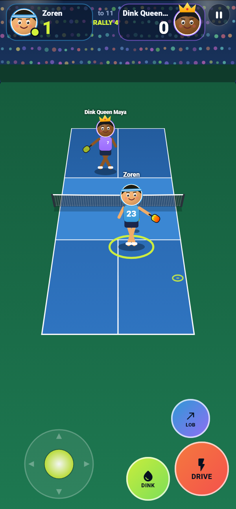
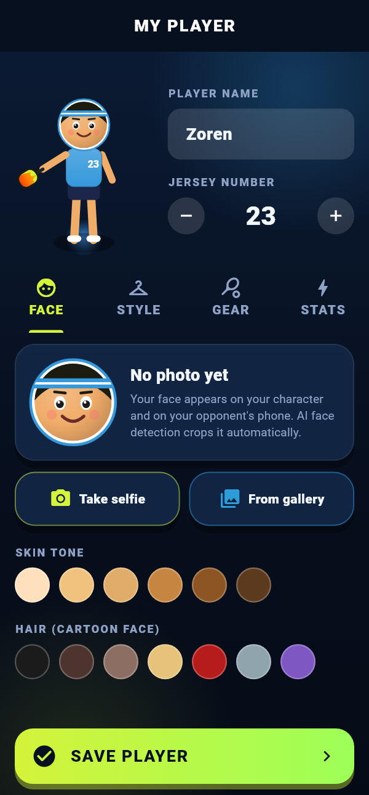
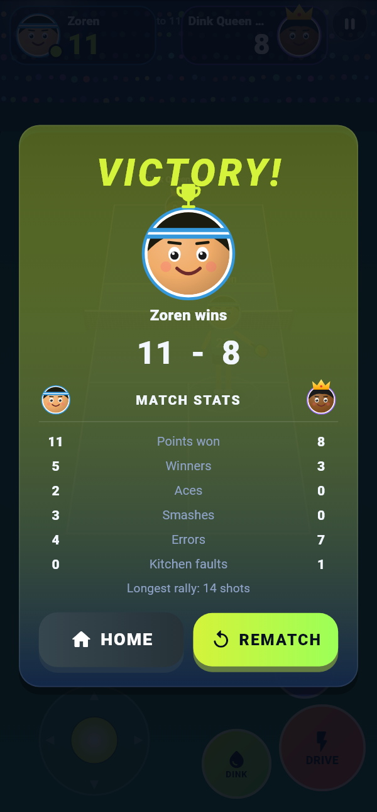

# Pickle Arena

**A mobile pickleball game with a neural-network AI opponent, phone-vs-phone Wi-Fi multiplayer,
and characters that wear your own face.** Built with Flutter (Android) and TensorFlow/Keras.

<p align="center">
  
  
  
  
</p>

**Download:** get the APK from the [Releases](../../releases/latest) page
(`PickleArena-arm64.apk` works on most phones; use `PickleArena-universal.apk` for older 32-bit phones).

**Tech:** Flutter / Dart (custom 2.5D renderer, no game engine) · TensorFlow / Keras · NumPy ·
Google ML Kit face detection · UDP discovery + TCP sockets · Kotlin (Android multicast lock)

## Features

- **VS AI mode** – 5 AI opponents driven by two neural networks trained in Python (TensorFlow/Keras).
- **Wi-Fi multiplayer** – phone vs phone on the same Wi-Fi network or a phone hotspot. No internet needed.
- **Character customization** – your own face (selfie or gallery, auto-cropped with ML Kit face detection),
  jersey/shorts/shoe colors, paddle color and design, headwear, jersey number and skill points
  (Speed / Power / Control).
- **Phone controls** – floating touch joystick + DRIVE / DINK / LOB buttons, or tilt-to-move with the
  accelerometer. Haptic feedback on hits.
- Real pickleball rules: diagonal underhand serve, two-bounce rule, kitchen (non-volley zone),
  out / net / double-bounce faults, rally or traditional side-out scoring, win by 2.

## Folder structure

```
pickle_arena/
├─ lib/
│  ├─ main.dart                 app start (loads profile + AI model)
│  ├─ app_state.dart            profile, settings, win/loss record (shared_preferences)
│  ├─ models/profile.dart       player look, stats, face photo
│  ├─ game/
│  │  ├─ physics.dart           exact ball physics (gravity + drag, bounces, net)
│  │  ├─ shot_planner.dart      turns "DRIVE to that spot" into a launch velocity
│  │  ├─ game_state.dart        match state + network snapshot format
│  │  ├─ engine.dart            rules, scoring, hitting, movement (authoritative)
│  │  ├─ session.dart           VS-AI / Host / Client sessions (client-side prediction)
│  │  ├─ ai/brain.dart          runs the trained neural networks on the phone
│  │  ├─ ai/ai_controller.dart  AI player logic + difficulty levels
│  │  ├─ ai/roster.dart         the 5 AI opponents
│  │  └─ render/                2.5D court, bobble-head characters with face photos, effects
│  ├─ net/lan.dart              UDP room discovery + TCP game connection
│  ├─ services/face_service.dart camera/gallery + ML Kit face detection + crop
│  ├─ screens/                  home, customize, face crop, VS AI, lobby, game, settings, guide
│  └─ ui/                       theme, joystick/buttons/tilt, avatars
├─ assets/ai/pickle_brain.json  trained weights (exported by training/train_ai.py)
├─ training/
│  ├─ pickle_sim.py             Python twin of the game physics
│  ├─ train_ai.py               data generation + training + export
│  └─ outputs/                  training curves, accuracy plots, learned policy map, metrics.json
└─ test/                        physics/AI parity tests, rules, full AI match, LAN loopback test
```

## The AI ("PickleBrain")

Both networks are trained on data from `training/pickle_sim.py`, which uses the same closed-form ball
physics as `lib/game/physics.dart`, so what the AI learns is exactly what happens in the game.

| Network | Architecture | Input | Output | Labels |
|---|---|---|---|---|
| Trajectory Predictor | MLP 7→128→128→64 + 4 heads | ball position & velocity, a depth `y` on the AI's side | where/when the ball reaches that depth (x, height, time), whether it gets there, how many bounces before it, next bounce point | exact physics simulation (460k samples) |
| Shot Selector | MLP 9→96→96→9 softmax | AI contact point, opponent position, ball speed, two-bounce flag, AI power & control | probability of 9 shots: {drive, dink, lob} × {left, centre, right} | Monte Carlo roll-outs: every shot simulated 10× with execution noise vs. a simulated opponent; expected rally-win rate → soft labels (30k situations) |

How the AI plays: when you hit, it asks the predictor "if I stand at depth y, where and when can I
meet the ball?" for 13 depths, throws away illegal options (two-bounce rule, volleying in the kitchen,
ball bouncing twice, too high/low, cannot get there in time), and runs to the best one. When the ball
arrives, the shot selector picks the shot. It also lets balls go when the predictor says they will
land out. Difficulty only changes reaction time, speed, aiming noise and how random the shot choice
is (softmax temperature).

Test results (from `training/outputs/metrics.json`):

- Predictor: average error 6.3 cm (sideways), 4.4 cm (height), 13 ms (timing); 99.5% bounce-count accuracy.
- Selector: 70.6% expected rally-win rate vs 72.5% best possible, 50.1% random shots, 57.1% always-drive.

Retrain (about 10 minutes on a CPU):

```
..\.venv\Scripts\python.exe training\train_ai.py
```

## Running the app

Requirements: Flutter SDK, Android SDK, JDK 21. On this PC they are in `C:\Users\admin\dev`.

Easiest: run the build script (safe to re-run, downloads resume if the internet drops):

```powershell
powershell -ExecutionPolicy Bypass -File build_apk.ps1
```

Or manually:

```powershell
$env:Path = "C:\Users\admin\dev\flutter\bin;" + $env:Path
$env:JAVA_HOME = "C:\Users\admin\dev\jdk-21.0.13+9"
flutter pub get
flutter test test/ai_and_physics_test.dart test/lan_test.dart test/widget_test.dart
flutter build apk --release
```

The first build downloads Gradle and the Android libraries (several hundred MB). The APK is written to
`build/app/outputs/flutter-apk/app-release.apk`. Copy it to each phone and install it
(allow "install unknown apps"). Or connect a phone with USB debugging and run `flutter run`.

`test/screenshot_capture.dart` renders PNG screenshots of every screen without a phone:

```powershell
flutter test test/screenshot_capture.dart --dart-define=OUT=build/screens --dart-define=FONTS=C:/Users/admin/dev/flutter/bin/cache/artifacts/material_fonts
```

## Playing multiplayer

1. Put both phones on the same Wi-Fi, **or** turn on the Hotspot on one phone and connect the other to it.
2. Phone A: **Multiplayer → Host a game** (with a hotspot, the hotspot phone should host).
3. Phone B: **Multiplayer → Join a game** and tap the room. If it doesn't appear, type the IP shown on phone A.
4. The host picks the points and scoring and taps **Start match**.

The host phone runs the game engine and sends 30 snapshots per second; the joining phone sends its
joystick/buttons and predicts its own movement so it feels instant.
